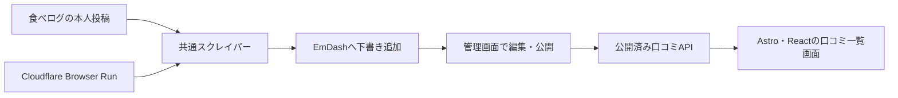

# 食べログ口コミ収集・閲覧システム 設計書

## 1. 目的

本人が食べログへ投稿した口コミをCloudflare上で収集・保存し、一覧表示する。

## 2. 設計方針

1. 食べログ固有の巡回・抽出処理を実行環境から分離する。
2. ブラウザー操作と保存処理をインターフェースで分離する。
3. 取得結果を検証してから新規分だけCMSへ下書き追加し、既存の編集内容と公開状態を保持する。
4. 食べログへの投稿や文章生成は行わない。
5. 異常を隠すフォールバックは実装しない。

## 3. スコープ

### 3.1 対象

- 本人が投稿した口コミの収集
- 口コミ詳細URLに基づく安定したIDの生成
- Cloudflare Browser Runによる収集
- Cloudflare D1への保存
- 口コミ一覧画面と一覧API
- WorkerのヘルスチェックAPI

### 3.2 対象外

- 口コミ文章の生成
- 食べログへの自動投稿
- 他者の口コミ収集
- 複数利用者への提供
- 画像解析

## 4. システム構成

### 4.1 Cloudflare

| サービス | 責務 |
| --- | --- |
| Worker | Astroのページ・APIとCMSの定期保守を実行する |
| Static Assets | Astroが生成したCSSやブラウザー用JavaScriptを配信する |
| Browser Run | 食べログを巡回する |
| D1 | EmDashのコンテンツと、成功した口コミ収集日時を保存する |
| KV | EmDashのセッションを保持する |

## 5. データ

| 項目 | 内容 |
| --- | --- |
| `id` | 口コミ詳細URL由来のID |
| `name` | 店舗名 |
| `url` | 店舗ページURL |
| `detailUrl` | 口コミ詳細URL |
| `title` | 口コミタイトル。取得できない場合は`null` |
| `body` | 口コミ本文。取得できない場合は`null` |
| `reviewDate` | 訪問年月。`YYYY-MM`形式 |
| `rating` | 評価値 |
| `likeCount` | いいね数 |

## 6. API

| メソッド | パス | 用途 |
| --- | --- | --- |
| `GET` | `/api/health` | Workerの生存確認 |
| `GET` | `/api/reviews` | 口コミ一覧と最終取得日時の取得 |

`/api/health`はD1などの外部依存サービスを確認しない。依存サービスの一時障害とWorker自体の障害を分けるためである。

## 7. 更新処理

1. 管理画面で認証・権限確認後に取り込みを実行する。
2. Browser Runで食べログの一覧・詳細ページを巡回し、取得結果を検証する。
3. CMSの既存口コミとゴミ箱を照合し、新規分だけ下書きとして追加する。
4. 全件の保存成功後に `app_review_sync` の成功日時を更新する。
5. 管理画面で編集・公開した口コミだけを、公開版専用のCMSクエリで取得する。

収集失敗時は保存を開始しない。保存途中の失敗では追加済み下書きを保持し、再実行時に重複を除外する。CronはCMSの公開予約・保守だけを実行し、口コミ収集は起動しない。

## 8. エラー方針

- ページ取得時のHTTPステータスが正常でない場合は停止する。
- 口コミ情報や数値を正しく取得できない場合は停止する。
- CMS保存に失敗した場合は成功日時を進めず、既存の編集・公開状態を維持する。

## 9. 検証

- 型チェックと本番ビルドが成功する
- `/api/health`がHTTP 200を返す
- `/api/reviews`が口コミ一覧を返す
- 収集失敗時に既存データが維持される
