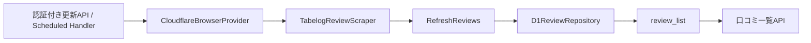

# Tabelog Writer

本人が食べログへ投稿した口コミを収集し、一覧で確認する個人用アプリです。

## 共通投稿への拡張

食べログと手入力を共通の `Post` として扱います。`kind` は `review` / `note` / `article`、`source` は `tabelog` / `manual` です。食べログの既存データと取得処理を保ち、手入力はEmDash管理画面の「手入力投稿」から作成します。

共通一覧は `/posts` と `/reviews`、APIは `/api/posts` です。既存の `/api/reviews` は食べログ専用として維持します。セットアップ済み環境では公開前に手入力用の保存先の準備が必要です。[設計・導入・復旧手順](docs/posts.md)を参照してください。

- 画面：React、Vite、Tailwind CSS、daisyUI
- API：TypeScript、Hono、Cloudflare Workers
- 口コミ収集：Cloudflare Browser Run
- 保存：Cloudflare D1

## Astro・EmDashへの本番切り替え

本番移行は [本番移行手順](docs/production-migration.md)、公開は [リリース手順](docs/releases.md) に従う。`npm run build:production` が本番Astroを生成し、タグのReleaseが公開する。`npm run build` は旧Vite構成の検証用として残す。以下の旧構成の説明は、切り替え前の照合と復旧のために保持している。

切り替え後は公開済みCMSデータだけを表示し、新規収集は下書きに追加する。全件入れ替えは行わない。CronはCMS保守のみで口コミ収集を起動しない。

## 口コミの取得項目

| 項目 | 型 | 内容 |
| --- | --- | --- |
| `id` | `string` | 口コミ詳細URL由来のID |
| `name` | `string` | 店舗名 |
| `url` | `string` | 店舗ページURL |
| `detailUrl` | `string` | 口コミ詳細URL |
| `title` | `string \| null` | 口コミタイトル |
| `body` | `string \| null` | 省略されていない口コミ本文 |
| `reviewDate` | `string` | 訪問年月。`YYYY-MM`形式 |
| `rating` | `number` | 投稿者が付けた点数 |
| `likeCount` | `number` | 口コミへのいいね数 |

食べログが公開している日付は訪問年月までのため、存在しない日を補完しません。

## スクレイピング構成

食べログの巡回・抽出処理はCloudflare上で実行し、取得結果をD1へ保存します。



ローカル開発と本番のどちらでも、口コミ一覧APIはD1の`review_list`ビューを参照する。D1は環境ごとに分離し、どちらもリモート接続を使用する。

| 実行方法 | 接続先D1 |
| --- | --- |
| `npm run dev` / `npm run dev:worker` / `npm run preview` | 開発用 `table-notes-development` |
| `npm run build` → `npm run deploy` | 本番用 `dining-archive-db` |

ローカルDBは使用しません。アプリをローカルで起動する場合も、開発用リモートD1 `table-notes-development` に接続します。本番D1 `dining-archive-db` とは分離します。ローカルでの書き込みも検証サイトと同じ開発用DBに反映されます。

Astro・EmDashの `npm run dev:astro` / `npm run preview:astro` も同じ方針です。`wrangler.astro.jsonc` のD1の `remote: true` と、Astroアダプターの `remoteBindings: true` で接続します。詳しくは[Astro開発手順](docs/astro-development.md)を参照してください。

開発用は `wrangler.jsonc` の `env.development` で定義し、起動・ビルド時の `CLOUDFLARE_ENV=development` で選択する。

## セットアップ

```bash
npm install
```

`TABELOG_USERNAME`（食べログURL上のユーザー名）はWrangler設定の `vars` で管理します。手動取り込みはEmDash管理画面のパスキー認証を使い、Basic認証の設定は不要です。

Browser RunとD1は`wrangler.jsonc`でリモートバインディングとして設定されています。ローカルから利用した場合もCloudflare側の利用量に加算されます。

## アプリのローカル起動

```bash
npm run dev
```

表示されたURLを開く。口コミ一覧は開発用リモートD1から読み取る。初回は空の一覧となる。

開発用D1のスキーマを更新する場合：

```bash
npx wrangler d1 migrations apply table-notes-development --env development --remote
```

旧 `POST /api/reviews/refresh` は廃止しました。手動取り込みはAstro・EmDash管理画面から行います。本番データは自動コピーしません。

## ヘルスチェック

Workerがリクエストを処理できることは、次のAPIで確認できます。

```bash
curl -i "http://localhost:5173/api/health"
```

正常時はHTTP 200と次のJSONを返します。D1などの外部依存サービスは確認しません。

```json
{"status":"ok"}
```

## BrunoでAPIを確認する

Bruno拡張またはデスクトップアプリで `bruno/` を開き、`checks` フォルダーを実行します。参照APIと廃止した取り込みAPIの404を確認できます。[Brunoの利用手順](docs/bruno.md)を参照してください。

## 管理画面から口コミを取り込む

Astro・EmDashの管理画面へパスキーでログインし、「口コミの取り込み」→「口コミを取り込む」を押します。新規分だけ下書きとして追加し、登録済みの内容を保持します。取得件数・追加件数・成功日時を確認後、口コミ一覧で編集・公開してください。

実行中の連打は防止します。保存途中に失敗した場合は追加済みの下書きを保持し、再実行時に重複を除外します。詳しくは[Astro開発・検証環境](docs/astro-development.md#管理画面からの手動取り込み34)を参照してください。

## ビルドとデプロイ

```bash
npm run build:astro
npm run build:production
```

本番への初回移行とDB準備は [本番移行手順](docs/production-migration.md) を参照。公開はmainのCI成功後に正式タグをpushする。`npm run deploy` もAstro本番を直接公開するため、通常運用はタグのReleaseを使う。

## 主なファイル

```text
.
├── migrations/
│   ├── 0001_initial_schema.sql
│   └── 0002_add_review_list_view.sql
├── src/
│   ├── reviews/
│   │   ├── review.ts
│   │   ├── refresh-reviews.ts
│   │   └── tabelog-review-scraper.ts
│   ├── infrastructure/
│   │   ├── cloudflare-browser-provider.ts
│   │   └── d1-review-repository.ts
│   ├── react-app/
│   └── worker/
│       ├── review-refresh-factory.ts
│       └── index.ts
├── wrangler.jsonc
└── package.json
```

### ファイルごとの役割

| ファイル | 役割 |
| --- | --- |
| `migrations/0001_initial_schema.sql` | `restaurants`と`reviews`のテーブル、制約、インデックスを作成する |
| `migrations/0002_add_review_list_view.sql` | 口コミ一覧APIが参照する`review_list`ビューを作成する |
| `src/reviews/review.ts` | アプリ内で共通して扱う口コミデータの型を定義する |
| `src/reviews/refresh-reviews.ts` | 口コミの取得とD1への全件保存を順番に実行する |
| `src/reviews/tabelog-review-scraper.ts` | 食べログの一覧・詳細ページを巡回し、口コミデータを抽出・検証する |
| `src/infrastructure/cloudflare-browser-provider.ts` | Browser Runをスクレイパーから利用できる形に変換する |
| `src/infrastructure/d1-review-repository.ts` | 口コミをD1へ保存し、`review_list`ビューから一覧を取得する |
| `src/worker/review-refresh-factory.ts` | Browser Run、スクレイパー、D1を組み合わせて口コミ更新処理を作る |
| `src/worker/index.ts` | APIルート、エラー処理、Scheduled Handlerを定義するWorkerの入口 |
| `src/react-app/main.tsx` | Reactアプリを初期化し、ルーターを有効にする |
| `src/react-app/App.tsx` | `/reviews`へのルーティングを定義する |
| `src/react-app/pages/PostListPage.tsx` | 共通APIから投稿を取得し、種類の絞り込みと口コミの評価順を提供する |
| `src/react-app/styles.css` | Tailwind CSSとdaisyUIを読み込み、画面全体のスタイルを定義する |
| `wrangler.jsonc` | Worker、Browser Run、D1、静的ファイル配信の設定を管理する |
| `package.json` | npmコマンドと利用パッケージを管理する |

## エラーとして停止する条件

- ページ取得時のHTTPステータスが正常でない
- 一覧から口コミ情報を取得できない
- 訪問年月が`YYYY/MM 訪問`形式ではない
- 点数またはいいね数を数値へ変換できない
- 全投稿でいいね要素が見つからない
- D1への一括保存が失敗する

食べログ側のHTML構造変更を空データとして保存せず、既存データを維持するための条件です。

## 注意事項

- 食べログ側のHTML構造が変わると、CSSセレクターの修正が必要です。
- Browser RunからのアクセスはBotとして識別されます。対象サイトの判断により取得できなくなる可能性があります。
- 実行頻度、取得データの範囲、利用方法について対象サイトの利用条件を確認してください。
- Browser Runの利用量はCloudflareダッシュボードで確認してください。

## 移行設計

Astro・EmDashの起動・検証・管理者登録・取り込み手順は [Astro開発・検証環境](docs/astro-development.md) を参照。Astro検証環境では新規口コミをCMSへ下書き追加し、公開済みの内容だけを表示する。本番切り替え前の準備と検証状況は [本番移行手順](docs/production-migration.md) を参照。

Astro・EmDashへの移行後の構成は [移行設計](docs/emdash-migration.md) を参照。現在の実装仕様と区別して管理する。

## 開発とリリースの運用

最新の `main` から作業ブランチを作成し、検証後に `main` 向けPRを作成する。完了するIssueはPR本文の `Closes #番号` で関連付ける。開発用Worker・D1は引き続き本番と分離する。

リリースはmain上の `vMAJOR.MINOR.PATCH` タグで管理する。タグpushによるGitHub Actionsの本番デプロイの初回設定・手順・復旧方法は [リリース手順](docs/releases.md) を参照。運用方針は [運用規則](.github/CONTRIBUTING.md) に記載する。
