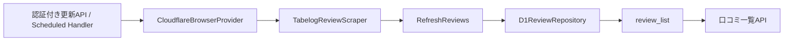

# Tabelog Writer

本人が食べログへ投稿した口コミを収集し、一覧で確認する個人用アプリです。

- 画面：Astro、React、Tailwind CSS、daisyUI
- API：Astro、TypeScript、Hono、Cloudflare Workers
- 口コミ収集：Cloudflare Browser Run
- 保存・管理：EmDash、Cloudflare D1

## Astro・EmDashへの本番切り替え

Astroのルートはプロジェクト直下に統一し、画面は `src/`、静的ファイルは `public/`、型チェック設定は `tsconfig.json` に置く。EmDashの初期設定は `seed/seed.json`、DB更新用SQLは `migrations/emdash/` で管理する。

### 実行コマンド

| コマンド | 用途 |
| --- | --- |
| `npm run dev` | stagingの設定で開発サーバーを起動 |
| `npm run check` | Astro・TypeScriptの型チェック |
| `npm run build` / `npm run build:staging` | staging用ビルド（`dist/astro/`） |
| `npm run preview` | ビルド済みのstaging版をローカルで確認 |
| `npm run build:production` | 本番用ビルド（`dist/astro-production/`） |
| `npm run deploy` | 本番用ビルドと公開 |
| `npm run deploy:staging` | staging用ビルドと公開 |
| `npm run types` | Astro用のCloudflareバインディング型を生成 |
| `npm test` / `npm run test:cms` | 単体テスト / 起動済みCMSの結合テスト |

stagingは `wrangler.astro.jsonc` の検証用Worker・D1を使用する。`preview` の前に `npm run build` を実行する。

検証用D1は `table-notes-staging` にデータを移行済み。旧 `table-notes-development` は移行時点の復旧用として保持しており、現在の接続先ではない。

stagingのURL：<https://staging.pakoirileo.nokishita.app>（Workers URL：<https://table-notes-astro-staging.pandalize.workers.dev>）

本番移行は [本番移行手順](docs/production-migration.md)、公開は [リリース手順](docs/releases.md) に従う。`npm run build:production` が本番Astroを生成し、タグのReleaseが公開する。`npm run dev`・`npm run build`・`npm run preview` はAstro版を実行する。旧Vite構成の実行コマンドは削除した。以下の旧構成の説明は、切り替え前の照合と復旧のために保持している。

切り替え後は公開済みCMSデータだけを表示し、新規収集は下書きに追加する。全件入れ替えは行わない。CronはCMS保守のみで口コミ収集を起動しない。

## 口コミの取得項目

| 項目 | 型 | 内容 |
| --- | --- | --- |
| `id` | `string` | 口コミ詳細URL由来のID |
| `name` | `string` | 店舗名 |
| `url` | `string` | 店舗ページURL |
| `detailUrl` | `string` | 口コミ詳細URL |
| `title` | `string \| null` | 口コミタイトル |
| `body` | `string \| null` | 省略されていない口コミ本文 |
| `reviewDate` | `string` | 訪問年月。`YYYY-MM`形式 |
| `rating` | `number` | 投稿者が付けた点数 |
| `likeCount` | `number` | 口コミへのいいね数 |

食べログが公開している日付は訪問年月までのため、存在しない日を補完しません。

## スクレイピング構成

食べログの巡回・抽出処理はCloudflare上で実行し、取得結果をD1へ保存します。



ローカル開発と本番のどちらでも、口コミ一覧APIはD1の`review_list`ビューを参照する。D1は環境ごとに分離し、どちらもリモート接続を使用する。

| 実行方法 | 接続先D1 |
| --- | --- |
| `npm run dev` / `npm run build` / `npm run preview` | 開発用 `table-notes-staging` |
| `npm run build:production` → `npm run deploy` | 本番用 `dining-archive-db` |

ローカルDBは使用しません。アプリをローカルで起動する場合も、開発用リモートD1 `table-notes-staging` に接続します。本番D1 `dining-archive-db` とは分離します。ローカルでの書き込みも検証サイトと同じ開発用DBに反映されます。

Astro・EmDashの `npm run dev` / `npm run preview` も同じ方針です。`wrangler.astro.jsonc` のD1の `remote: true` と、Astroアダプターの `remoteBindings: true` で接続します。詳しくは[Astro開発手順](docs/astro-development.md)を参照してください。

stagingは `wrangler.astro.jsonc`、本番は `wrangler.astro.production.jsonc` で定義する。

## セットアップ

```bash
npm install
```

`TABELOG_USERNAME`（食べログURL上のユーザー名）はWrangler設定の `vars` で管理します。手動取り込みはEmDash管理画面のパスキー認証を使い、Basic認証の設定は不要です。

Browser RunとD1は`wrangler.jsonc`でリモートバインディングとして設定されています。ローカルから利用した場合もCloudflare側の利用量に加算されます。

## アプリのローカル起動

```bash
npm run dev
```

表示されたURLを開く。口コミ一覧は開発用リモートD1から読み取る。初回は空の一覧となる。

開発用D1のスキーマを更新する場合：

```bash
npx wrangler d1 migrations apply table-notes-staging --config wrangler.astro.jsonc --remote
```

旧 `POST /api/reviews/refresh` は廃止しました。手動取り込みはAstro・EmDash管理画面から行います。本番データは自動コピーしません。

## ヘルスチェック

Workerがリクエストを処理できることは、次のAPIで確認できます。

```bash
curl -i "http://localhost:5173/api/health"
```

正常時はHTTP 200と次のJSONを返します。D1などの外部依存サービスは確認しません。

```json
{"status":"ok"}
```

## BrunoでAPIを確認する

Bruno拡張またはデスクトップアプリで `bruno/` を開き、`checks` フォルダーを実行します。参照APIと廃止した取り込みAPIの404を確認できます。[Brunoの利用手順](docs/bruno.md)を参照してください。

## 管理画面から口コミを取り込む

Astro・EmDashの管理画面へパスキーでログインし、「口コミの取り込み」→「口コミを取り込む」を押します。新規分だけ下書きとして追加し、登録済みの内容を保持します。取得件数・追加件数・成功日時を確認後、口コミ一覧で編集・公開してください。

実行中の連打は防止します。保存途中に失敗した場合は追加済みの下書きを保持し、再実行時に重複を除外します。詳しくは[Astro開発・検証環境](docs/astro-development.md#管理画面からの手動取り込み34)を参照してください。

## ビルドとデプロイ

```bash
npm run build
npm run build:production
```

本番への初回移行とDB準備は [本番移行手順](docs/production-migration.md) を参照。公開はmainのCI成功後に正式タグをpushする。`npm run deploy` もAstro本番を直接公開するため、通常運用はタグのReleaseを使う。

## ディレクトリの役割

[Astro公式の構成例](https://docs.astro.build/en/basics/project-structure/)に合わせ、画面を `components/`、共通CSSを `styles/` に配置する。サーバー側の処理は `lib/` にまとめる。`pages/` の配置でURLが決まり、それ以外は役割ごとの整理としている。

```text
src/
├── pages/                 # URLに対応するページとAPIの入口
│   ├── index.astro
│   ├── reviews.astro
│   └── api/[...path].ts
├── layouts/               # ページ共通のHTMLの枠
│   └── SiteLayout.astro
├── components/            # Astroページから使う画面部品
│   └── ReviewListPage.tsx
├── styles/                # 共通CSS
│   └── global.css
├── lib/                   # 画面から独立した処理
│   ├── review-api.ts      # 公開APIの応答
│   ├── reviews/           # 口コミの型、収集、取り込み手順
│   └── cms/               # EmDashへの保存・公開参照・管理画面の拡張
├── worker.ts              # Cloudflareの入口とCMSの定期保守
├── live.config.ts         # AstroとEmDashのデータ読み込みを接続
├── env.d.ts               # 環境・外部サービスの型を読み込む
└── legacy/                # 移行前のWorkerとD1への全件保存
```

`lib/cms/` はCMS本体ではなく、このアプリとEmDashをつなぐコードを置く。

| ファイル | 役割 |
| --- | --- |
| `review-import-admin.tsx` | 管理画面の取り込みボタンと結果表示 |
| `review-import-plugin.ts` | 管理画面の登録と、権限付きの取り込み実行口 |
| `import-reviews.ts` | 食べログからの収集とCMS保存の組み立て |
| `review-store.ts` | 登録済みの照合、新規口コミの下書き保存、成功日時の記録 |
| `review-data.ts` | アプリとCMSのデータ形式の変換 |
| `review-api-dependencies.ts` | 公開済み口コミを取得してAPIへ渡す |
| `review-policy.mjs` | 取得元ID・URL・初回取り込み日時の変更を防ぐ |

公開画面では `pages/reviews.astro` → `components/ReviewListPage.tsx` → `/api/reviews` → `lib/cms/` の順に口コミを読み込む。手動取り込みでは、管理画面 → `lib/cms/` → `lib/reviews/` で収集し、新規分だけCMSへ下書き保存する。

`legacy/` は現在のAstroの起動経路では使わない。旧 `wrangler.jsonc` からの起動と、移行前の動作を確認するテストのために保持する。旧Reactアプリの入口と重複するホーム画面は削除し、口コミ一覧とCSSはAstroで引き続き使う。ルートの `vite.config.ts` と `tsconfig.node.json` は旧Vite構成の設定であり、通常の起動・ビルドはAstroを使う。

そのほかの主なディレクトリは次のとおり。

| ディレクトリ | 役割 |
| --- | --- |
| `public/` | 加工せず配信する画像など |
| `seed/` | EmDashの初期設定 |
| `migrations/emdash/` | CMS連携で使う追加テーブルのSQL |
| `migrations/` 直下 | 旧D1構成のテーブルとビューのSQL |
| `scripts/` | データ移行・リリースの補助処理 |
| `tests/` | 単体テストとCMSの結合テスト |
| `bruno/` | APIを手動確認するリクエスト集 |

## エラーとして停止する条件

- ページ取得時のHTTPステータスが正常でない
- 一覧から口コミ情報を取得できない
- 訪問年月が`YYYY/MM 訪問`形式ではない
- 点数またはいいね数を数値へ変換できない
- 全投稿でいいね要素が見つからない
- D1への一括保存が失敗する

食べログ側のHTML構造変更を空データとして保存せず、既存データを維持するための条件です。

## 注意事項

- 食べログ側のHTML構造が変わると、CSSセレクターの修正が必要です。
- Browser RunからのアクセスはBotとして識別されます。対象サイトの判断により取得できなくなる可能性があります。
- 実行頻度、取得データの範囲、利用方法について対象サイトの利用条件を確認してください。
- Browser Runの利用量はCloudflareダッシュボードで確認してください。

## 移行設計

Astro・EmDashの起動・検証・管理者登録・取り込み手順は [Astro開発・検証環境](docs/astro-development.md) を参照。Astro検証環境では新規口コミをCMSへ下書き追加し、公開済みの内容だけを表示する。本番切り替え前の準備と検証状況は [本番移行手順](docs/production-migration.md) を参照。

Astro・EmDashへの移行後の構成は [移行設計](docs/emdash-migration.md) を参照。現在の実装仕様と区別して管理する。

## 開発とリリースの運用

最新の `main` から作業ブランチを作成し、検証後に `main` 向けPRを作成する。完了するIssueはPR本文の `Closes #番号` で関連付ける。開発用Worker・D1は引き続き本番と分離する。

リリースはmain上の `vMAJOR.MINOR.PATCH` タグで管理する。タグpushによるGitHub Actionsの本番デプロイの初回設定・手順・復旧方法は [リリース手順](docs/releases.md) を参照。運用方針は [運用規則](.github/CONTRIBUTING.md) に記載する。
