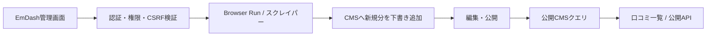

# Tabelog Writer

本人が食べログへ投稿した口コミを収集し、EmDash管理画面で編集・公開する個人用アプリです。公開一覧にはCMSの公開版だけを表示し、新規収集分は下書きとして追加します。

- 画面・ルーティング：Astro、React、Tailwind CSS、daisyUI
- 公開API：TypeScript、Hono
- CMS・認証：EmDash、パスキー
- 実行・保存：Cloudflare Workers、D1、KV
- 口コミ収集：Cloudflare Browser Run、Playwright

## 開発と確認

`.node-version` のNode.jsを使い、依存関係をインストールします。

```bash
npm ci
npm run dev
```

開発サーバーのURLは起動時の表示を確認してください。`/` がホーム、`/reviews` が口コミ一覧、`/_emdash/admin` が管理画面です。初回はEmDashの案内に従って管理者を登録し、パスキーでログインします。

| コマンド | 用途 |
| --- | --- |
| `npm run dev` | stagingの設定で開発サーバーを起動 |
| `npm run check` | Astro・TypeScriptの型チェック |
| `npm test` | 外部サービスを置き換えた単体・HTTP境界テスト |
| `npm run build` / `npm run build:staging` | staging用ビルド（`dist/astro/`） |
| `npm run preview` | ビルド済みのstaging版をローカルで確認 |
| `npm run build:production` | 本番用ビルド（`dist/astro-production/`） |
| `npm run types` | staging設定からバインディング・Worker実行環境の型を生成 |
| `npm run test:cms` | 起動済みCMSに接続する結合テスト |
| `npm run deploy:staging` | staging用ビルドと公開 |
| `npm run deploy` | 本番用ビルドと公開 |

`preview` の前には `npm run build` を実行します。CMS結合テストの接続先・認証情報・書き込み範囲は [tests/cms.integration.mjs](tests/cms.integration.mjs) を確認してください。

## 開発環境もstagingのリモートD1を使う

| 設定 | Worker | D1 | KVセッション |
| --- | --- | --- | --- |
| `wrangler.astro.jsonc` | `table-notes-astro-staging` | `table-notes-staging` | staging用 |
| `wrangler.astro.production.jsonc` | `dining-archive` | `dining-archive-db` | 本番用 |

`dev`・`build`・`preview` はstaging設定を使います。`build:production` だけが本番設定を選びます。D1の `remote: true` とAstroアダプターの `remoteBindings: true` により、ローカル起動時もstagingの実データを読み書きします。ローカルDBは使いません。

staging：<https://staging.pakoirileo.nokishita.app>（Workers URL：<https://table-notes-astro-staging.pandalize.workers.dev>）

本番：<https://pakoirileo.nokishita.app>

`TABELOG_USERNAME` は両設定の `vars` で管理します。Browser Runの利用量はローカル起動時もCloudflare側へ加算されます。

staging用の追加マイグレーションは、対象DBを確認してから適用します。

```bash
npx wrangler d1 migrations apply table-notes-staging --config wrangler.astro.jsonc --remote
```

## 管理画面から新しい口コミを取り込む

管理画面へログインし、「口コミの取り込み」から「口コミを取り込む」を押します。取得件数・追加件数・成功日時を確認後、口コミ一覧で下書きを編集・公開してください。EmDash標準の権限とCSRF検証を通して実行します。

新規分だけを追加し、登録済みの本文・公開状態・ゴミ箱を保持します。実行中の連打は防止します。保存途中に失敗した場合は追加済みの下書きを保持し、再実行時は重複を除外します。CronはCMSの公開予約・保守専用で、口コミ収集を起動しません。



収集時にHTTP異常、必須要素の欠落、日付・点数・いいね数の形式不正、全投稿のいいね要素欠落、0件を検出した場合は停止します。収集・保存の失敗を成功として扱いません。食べログのHTML構造が変わった場合は、スクレイパーのセレクターを確認してください。

## 公開APIと取得項目

| API | 動作 |
| --- | --- |
| `GET /api/health` | `{"status":"ok"}`。DBなどの外部サービスは確認しない |
| `GET /api/reviews` | CMS公開口コミの `reviews` と最終収集日時 `lastUpdatedAt` を返す |
| `POST /api/reviews/refresh` | 廃止済み。404を返す |

Brunoでは `bruno/` の `checks` フォルダーを使って参照APIと廃止済みAPIの404を確認できます。開発サーバーのURLに合わせて環境の接続先を設定してください。

| 項目 | 型 | 内容 |
| --- | --- | --- |
| `id` | `string` | 口コミ詳細URL由来のID |
| `name` | `string` | 店舗名 |
| `url` | `string` | 店舗ページURL |
| `detailUrl` | `string` | 口コミ詳細URL |
| `title` / `body` | `string \| null` | 口コミタイトル・省略されていない本文 |
| `reviewDate` | `string` | 訪問年月（`YYYY-MM`） |
| `rating` | `number` | 投稿者が付けた点数 |
| `likeCount` | `number` | 食べログ上のいいね数 |

食べログが公開している日付は訪問年月までのため、存在しない日を補完しません。

## ビルドして公開する

公開前に `main` 向けPRで差分と検証結果を確認します。

```bash
npm test
npm run build:staging
npm run build:production
```

公開する環境に応じて `npm run deploy:staging` または `npm run deploy` を実行します。各コマンドは対象環境のAstroをビルドし、生成された `server/wrangler.json` を使って公開します。`wrangler deploy` の設定省略による旧Workerへの公開は行いません。

現在、このリポジトリにCI・タグ公開ワークフローはありません。タグのpushだけでは公開されません。`scripts/release.mjs` は正式タグと本番生成設定の照合用として残していますが、自動デプロイを起動するものではありません。共通のリリース規則は [docs/rules/release.md](docs/rules/release.md) を参照してください。

## 主なファイルと旧データの保全

[Astro公式の構成例](https://docs.astro.build/en/basics/project-structure/)に合わせ、画面部品は `src/components/`、共通CSSは `src/styles/`、サーバー側の共通処理は `src/lib/` に置きます。`src/pages/` の配置でURLが決まり、Cloudflareの入口は `src/worker.ts` です。`src/lib/cms/` はCMS本体ではなく、このアプリとEmDashをつなぐコードです。

| ファイル・ディレクトリ | 役割 |
| --- | --- |
| `astro.config.mjs` | Astro、React、EmDash、環境別出力の設定 |
| `src/pages/` / `src/layouts/` | ホーム・口コミ一覧・公開APIと共通レイアウト |
| `src/components/ReviewListPage.tsx` | 口コミ一覧の対話操作 |
| `src/styles/global.css` | Tailwind CSS・daisyUIと共通スタイル |
| `src/lib/cms/` | 公開データ変換、取り込み、重複防止と管理画面 |
| `src/lib/reviews/tabelog-review-scraper.ts` | 一覧・詳細ページの巡回、抽出と形式検証 |
| `src/lib/reviews/cloudflare-browser-provider.ts` | Browser Runとスクレイパーの接続 |
| `src/worker.ts` | Astroへのリクエスト委譲とCMS保守Cron |
| `src/lib/hono-app.ts` | Honoの公開APIとエラー応答 |
| `seed/seed.json` | CMSコレクションの初期設定 |
| `migrations/emdash/` | 現行D1用の追加SQL |
| `cloudflare.d.ts` | 現行staging設定から生成したバインディング・実行環境の型 |

旧Vite・SPA・全件置換Workerの入口、専用設定・依存は撤去しています。旧DBのテーブル・ビューと適用済みSQL（`migrations/0001_initial_schema.sql`、`migrations/0002_add_review_list_view.sql`）は、データ保全と過去の適用履歴のため残しています。旧DBは通常の一覧・取り込みでは使用しません。

`scripts/migrate-reviews.mjs` は初期移行の照合・再実施に必要なため保持しています。既存CMSの編集やゴミ箱との不一致を上書きせず停止します。通常運用の取り込みには使いません。復旧時は対象環境のD1バックアップとCMS公開内容を照合し、過去の構成が必要ならGit履歴から取得してください。旧全件置換処理を現行DBへ接続しないでください。

手入力投稿・写真・いいねの公開前の設定は、[導入手順](docs/setup.md)を参照してください。
